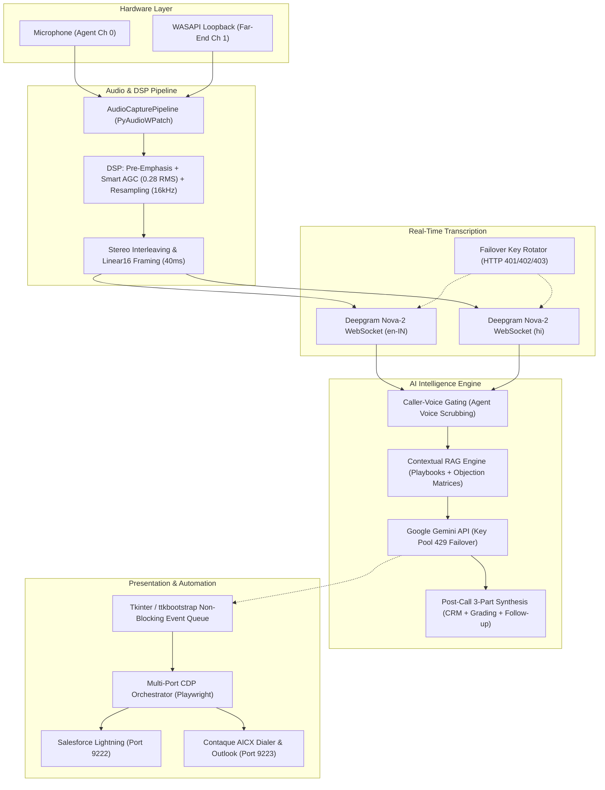

# Real-Time Conversational AI Copilot & CRM Orchestrator

[](https://www.python.org/downloads/)
[]()
[](LICENSE)
[]()

A production-grade, low-latency, real-time conversational intelligence and automation system engineered for high-velocity sales and admissions advisors. The platform captures duplex system audio via Windows Core Audio (WASAPI loopback), applies custom real-time digital signal processing (DSP/Smart AGC), streams dual-language audio to Deepgram Nova-2 WebSockets, conducts live contextual RAG with Google Gemini, and synchronizes bi-directional CRM workflows using Playwright over the Chrome DevTools Protocol (CDP).

---

## Architecture Overview



---

## Technical Highlights

### 1. Ultra-Low Latency Pipeline (<450ms E2E)
- **40ms Audio Framing**: Linear16 PCM chunks framed at 40ms intervals directly into non-blocking memory buffers.
- **Direct-to-Socket Streaming**: Interleaved stereo packets stream directly across persistent full-duplex WebSockets using native binary opcodes (`ABNF.OPCODE_BINARY`).
- **Concurrent Bilingual Recognition**: Runs simultaneous English-IN and Hindi Deepgram Nova-2 endpoints, disambiguating bilingual code-switching in real-time.

### 2. Custom DSP & Float32 Smart AGC Normalization
- **Float32 Energy Summing**: Downmixes multi-channel telephony audio to mono by casting to IEEE-754 `float32` prior to computing channel energy, eliminating 16-bit signed integer overflow crashes inherent in naive audio scrapers.
- **Smart AGC (Target 0.28 RMS)**: Dynamically scales variable-gain inputs. Extremely loud media or noisy line audio is attenuated, while quiet far-end softphone audio is cleanly boosted up to 20x.
- **First-Order Pre-Emphasis**: High-pass filter ($y[t] = x[t] - 0.85 \cdot x[t-1]$) sharpens speech frequencies (1 kHz to 4 kHz) before feeding neural ASR models.

### 3. Caller-Voice Gating
- Traditional AI assistants inject both the advisor's echo and the customer's speech into the LLM context, leading to repetitive echoing, hallucinated responses, and feedback loops.
- This copilot implements **Caller-Voice Gating**: the agent channel is isolated and filtered from the RAG ingestion stream. The Gemini prompt builder operates strictly on pure prospect dialogue, resulting in laser-focused real-time rebuttals.

### 4. Dynamic Contextual RAG Engine
- **Fuzzy Playbook Resolution**: Compares scraped CRM program titles against structured catalog playbooks via word-boundary token matching.
- **Modular Curriculum Injection**: Aggregates syllabus modules, fee structures, eligibility matrices, and objection-handling tactics from modular JSON databases without re-prompting.
- **Post-Call Analytical Synthesis**: Generates a 3-part wrap-up upon call termination:
  1. *Clean CRM Summary*: Bulleted prospect profile, motivations, and pain points without artificial headers or hallucinated placeholders.
  2. *Performance Grading*: Objective scoring of advisor objection handling and discovery depth.
  3. *Hyper-Personalized Email Draft*: Production-ready follow-up email incorporating prospect-specific conversation points.

### 5. Multi-Key Failover Pool (HTTP 429 & 403 Resilience)
- Implements round-robin key management across both Google GenAI and Deepgram clients.
- If Deepgram encounters an expired token or quota error (`401`/`402`/`403`), it automatically transitions to the next pool token and reconnects the socket.
- If Gemini returns a rate-limit exception (`HTTP 429`), the client rotates API keys with exponential backoff and retries seamlessly without interrupting the advisor's call.

### 6. Multi-Port Browser CDP Orchestration
- Controls decoupled browser sessions via Chrome DevTools Protocol (CDP):
  - **Port 9222**: Salesforce Lightning CTI Softphone (scrapes record layout items, monitors telephony states, executes PrimeNG dropdown auto-disposition).
  - **Port 9223**: Cloud Dialer (Contaque AICX) and Outlook Web Mail (dispatches authenticated HTML follow-up emails retaining native signatures).
  - **Port 9224**: AI Studio (optional web fallback interface).

---

## Directory Structure

```text
realtime-sales-ai-copilot/
├── automation/                 # Browser automation & outreach engine
│   ├── __init__.py
│   ├── browser_launcher.py     # Multi-port Chromium CDP process spawner
│   ├── crm_orchestrator.py     # Master Playwright automation coordinator
│   ├── contaque_client.py      # Cloud dialer controller
│   ├── outreach.py             # Omnichannel dispatchers (SMS, WhatsApp, Outlook)
│   ├── salesforce_client.py    # Salesforce Lightning CTI & disposition engine
│   ├── scrapers.py             # High-speed DOM probers
│   └── sheet_campaign.py       # Excel/CSV batch campaign progression manager
├── brain/                      # Artificial Intelligence & RAG engine
│   ├── __init__.py
│   ├── database.py             # Thread-safe local JSON persistence with fsync
│   ├── knowledge_loader.py     # Dynamic JSON curriculum loader
│   └── rag_engine.py           # Contextual RAG engine & caller-voice gating
├── config/                     # Configuration management
│   ├── __init__.py
│   └── settings.py             # Pydantic/dataclass environment loader
├── core/                       # Core audio acquisition & DSP pipeline
│   ├── __init__.py
│   ├── audio_capture.py        # WASAPI loopback + mic multi-threaded pipeline
│   ├── audio_governor.py       # Core Audio session volume controller (PyCaw)
│   └── dsp.py                  # Smart AGC, pre-emphasis, and safe float32 mono downmix
├── data/                       # Sanitized mock databases & playbooks
│   ├── knowledge_base/         # Modular curriculum specs (JSON)
│   ├── mock_leads.json         # Sanitized prospect test records
│   └── prompts.json            # Strategic sales persona playbooks
├── logs/                       # Application execution and diagnostic logs
├── transcription/              # Speech-to-Text streaming
│   ├── __init__.py
│   ├── caption_processor.py    # Decoupled transcript history buffer
│   └── deepgram_client.py      # Dual-language Nova-2 WebSocket manager
├── ui/                         # Workstation graphical user interface
│   ├── __init__.py
│   ├── actions.py              # Non-blocking GUI event handlers
│   ├── components.py           # Workstation layout (ttkbootstrap dark theme)
│   ├── events.py               # Non-blocking event loop pump
│   └── workstation.py          # Main application lifecycle coordinator
├── .env.example                # Documented configuration template
├── .gitignore                  # Production exclusion rules
├── LICENSE                     # MIT License
├── main.py                     # Application bootloader and CLI
└── requirements.txt            # Production dependencies
```

---

## Hardware & Audio Configuration

The pipeline requires capturing dual-channel audio in real time:
1. **Microphone (Channel 0)**: The local sales advisor speaking into their headset.
2. **WASAPI Loopback (Channel 1)**: The remote customer audio returned through the computer's sound card or softphone.

### Windows Audio Setup
1. Open Windows Sound Settings (`mmsys.cpl`).
2. Set your primary headset or communications device as the **Default Playback Device**.
3. When the application launches, select that same endpoint under the **WASAPI Loopback** dropdown.
4. The system will automatically capture and interleave both streams into stereo 16kHz linear16 PCM.

---

## Installation & Setup

### 1. Prerequisites
- **Operating System**: Windows 10/11 (required for PyAudioWPatch WASAPI loopback and PyCaw Core Audio APIs).
- **Python**: Version 3.10 or higher.
- **Google Chrome**: Installed in default program directories.

### 2. Clone & Setup Environment
```bash
git clone https://github.com/your-username/realtime-sales-ai-copilot.git
cd realtime-sales-ai-copilot

python -m venv .venv
.\.venv\Scripts\activate

pip install --upgrade pip
pip install -r requirements.txt
playwright install chromium
```

### 3. Configure Credentials
Copy the example environment template and populate your API credentials:
```bash
copy .env.example .env
```
Edit `.env` with your preferred text editor:
```ini
# Add your Gemini and Deepgram API keys (supports comma-separated rotation pools)
GEMINI_API_KEYS=AIzaSyA...Key1,AIzaSyB...Key2
DEEPGRAM_API_KEYS=77cac...Key1,88bad...Key2

# Configure your organization identity
ADVISOR_NAME=Senior Admissions Advisor
ORGANIZATION_NAME=Executive Education Consortium
```

### 4. Verify Configuration
Validate your configuration without starting the GUI:
```bash
python main.py --validate-config
```

### 5. Launch Workstation
```bash
python main.py
```

---

## Browser Automation (CDP) Setup

To allow Playwright to attach to active CRM tabs without interfering with personal browser state, launch Chrome instances with remote debugging:

1. Click **"Attach CDP Ports (9222-9224)"** directly within the Workstation UI.
2. The orchestrator spawns isolated, optimized Chrome profiles:
   - `Port 9222`: Dedicated Salesforce Lightning session.
   - `Port 9223`: Dedicated dialer and Outlook Web mail session.
   - `Port 9224`: AI Studio sandbox.
3. Log in once per profile; session cookies and tokens persist locally inside `%LOCALAPPDATA%\SalesCopilot\CDPProfiles`.

---

## Security & Sanitization

This repository has been engineered to adhere to strict enterprise security standards:
- **Zero Hardcoded Secrets**: All tokens, API keys, and device UUIDs are loaded strictly from the environment.
- **Zero Customer PII**: Real prospect phone numbers, emails, and call recordings are strictly excluded from version control. A clean, realistic dataset is provided in `data/mock_leads.json`.
- **Atomic File Syncing**: All lead updates and call notes flush to disk via `os.fsync()`, guarding against data corruption during unexpected system power events.

---

## License

This project is licensed under the MIT License — see the [LICENSE](LICENSE) file for details.
